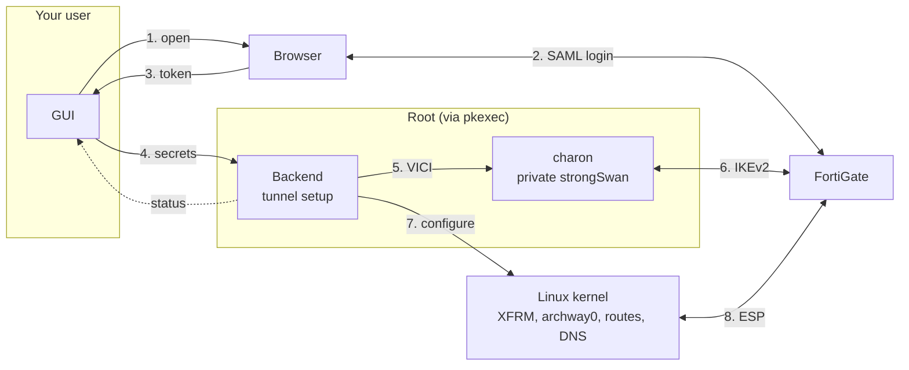
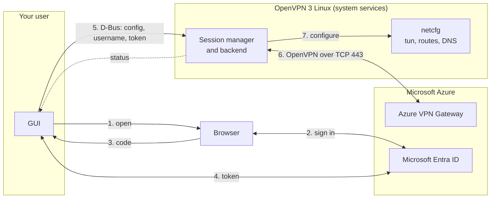

# Archway

Connect to your FortiGate IPsec (IKEv2) VPN with single sign-on on Linux, which Fortinet's own FortiClient can't do. Archway also connects to Azure VPN gateways that sign you in with Microsoft Entra ID, which has no supported Linux client since Microsoft retired its Azure VPN Client for Linux.

Archway is a desktop frontend for existing VPN engines. FortiGate connections run on [strongSwan](https://www.strongswan.org/), the open-source IPsec implementation, which handles the key exchange, encryption and tunnel; Archway adds the FortiGate SSO login and sets up routes and DNS. Azure VPN connections run on [OpenVPN® 3 Linux](https://github.com/OpenVPN/openvpn3-linux); Archway adds the Entra sign-in and the connection settings from the Azure profile.

> [!WARNING]
> Archway is in a very early stage. Expect bugs and rough edges. If something breaks, please open an issue with the log (turn on verbose logging in Settings first).
>
> Archway is a side project. Its main use is connecting to company networks. If you rely on a VPN to keep your traffic private or secure, please use another solution.


## Features

- **Azure VPN with Microsoft Entra ID.** Import the profile the Azure portal gives you and sign in through your browser. Archway runs these connections on OpenVPN 3 Linux.
- **FortiGate IPsec (IKEv2) with single sign-on.** Sign in through your own browser, with your organisation's usual login page, password manager and MFA, which Fortinet's FortiClient for Linux can't do. Classic username and password logins and pre-shared-key-only setups work too. Archway runs these connections on strongSwan.
- **Built on established VPN engines.** The tunnel itself is handled by open-source VPN software with a long track record: [strongSwan](https://www.strongswan.org/) for FortiGate connections and [OpenVPN 3 Linux](https://github.com/OpenVPN/openvpn3-linux) for Azure VPN. Archway adds the sign-in and the settings.
- **Flexible routing.** Send only your company's networks through the VPN, route all traffic through it, or pick the networks yourself.
- **Leak protection.** Archway uses the VPN's DNS so internal servers resolve by name, and in full-tunnel mode it blocks IPv6 so nothing bypasses the VPN.
- **Familiar settings.** Setting names and sections mirror FortiClient's, so you can copy a working configuration field by field. Most defaults match FortiClient's too; certificate verification on the SSO port is on by default.
- **Multiple connections.** Save as many VPN profiles as you need and switch between them in one click.
- **Secrets in your keyring.** Your VPN key and password go in your system's password manager (KWallet, GNOME Keyring, KeePassXC), never in a plain file.
- **Easy sharing.** Hand a working connection to a colleague as a single file.
- **Live status.** See your VPN address, connection time and traffic at a glance.
- **Minimal privileges.** The app itself never runs as administrator. FortiGate connections ask for your administrator password only while the tunnel is set up; Azure VPN connections don't ask at all.

## Supported platforms

Tested on:

- Fedora 44 (FortiGate and Azure VPN)
- Ubuntu 26.04.1 (FortiGate)

The release packages should also run on Debian 12 and 13, Ubuntu 24.04 and most other distributions released since late 2022 (glibc 2.36 or newer), but those haven't been tested. The technical requirements can be found [under 'requirements'](#requirements).

## Install

Download the packages from the [latest release](../../releases/latest): the app, plus the package for the VPN engine your connections run on. Each engine package only installs that engine, so you get only what you need. Install both with your package manager.

| Your connections | Engine | Package |
|---|---|---|
| FortiGate | strongSwan (IPsec IKEv2) and pkexec | `archway-vpn-ipsec` |
| Azure VPN | OpenVPN 3 Linux | `archway-vpn-openvpn` |

For FortiGate connections:

```bash
sudo dnf install ./archway-vpn-[0-9]*.rpm ./archway-vpn-ipsec-*.rpm       # Fedora
sudo apt install ./archway-vpn_*.deb ./archway-vpn-ipsec_*.deb             # Debian, Ubuntu
```

For Azure VPN connections, Debian 13 and Ubuntu 26.04 and newer ship OpenVPN 3 Linux. On Fedora, first add the [dsommers/openvpn3 Copr](https://copr.fedorainfracloud.org/coprs/dsommers/openvpn3/) (`sudo dnf copr enable dsommers/openvpn3`); on Ubuntu 24.04 and Debian 12, [OpenVPN's repository](https://community.openvpn.net/openvpn/wiki/OpenVPN3Linux). Then:

```bash
sudo dnf install ./archway-vpn-[0-9]*.rpm ./archway-vpn-openvpn-*.rpm      # Fedora
sudo apt install ./archway-vpn_*.deb ./archway-vpn-openvpn_*.deb           # Debian, Ubuntu
```

If you use both kinds of connection, install both engine packages. Archway tells you when an engine is missing.

On Arch Linux, build the package with the PKGBUILD in `packaging/aur/`, and install `strongswan` and `polkit` for FortiGate, or the `openvpn3` AUR package for Azure VPN (it needs `gdbuspp` from the AUR too; an AUR helper such as `yay` installs both). To build from source, see [Build and run](#build-and-run).

## Usage

1. Click **New Connection**, choose **FortiGate**, enter a name and the **Remote Gateway** (the FortiGate's address, for example `vpn.example.com`), and click **Add Connection**. Then fill in the Connection card:
   - **Pre-shared Key:** the phase 1 PSK. You need it even with SSO, because the gateway uses it to prove who it is.
2. Under **Sign-in**:
   - With SSO, turn on *Enable Single Sign On (SSO) for VPN Tunnel* and set **SSO Port** to the FortiGate's `auth-ike-saml-port`, for example 10443.
   - Without SSO, choose *Username and password (EAP)* or *None (pre-shared key only)*.
3. If your FortiGate or EMS profile needs it, adjust **VPN Settings**, **Phase 1**, **Phase 2** and **Network**. The defaults are FortiClient's: AES128-SHA1 and AES256-SHA256 with DH group 20.
4. Click **Connect**. With SSO your browser opens; log in there. Then the system asks for your password. Once the tunnel is up, the status shows **Connected**.
5. Click **Disconnect** to close the tunnel. Closing the window disconnects too.

### Azure VPN (Microsoft Entra ID)

This works for Azure VPN gateways with Point-to-Site set to the OpenVPN tunnel type and Microsoft Entra ID authentication.

1. In the Azure portal, open the gateway's **Point-to-site configuration** and click **Download VPN client**, or ask your administrator for that zip file.
2. Click **New Connection**, choose **Azure VPN**, click **Choose File…** and pick the zip. Archway reads the profile in its `AzureVPN` folder; the `azurevpnconfig.xml` from there on its own works too. Check what it shows and click **Import Profile**. Then click **Save**, which puts the server secret in your keyring.
3. Click **Connect** and sign in with your Microsoft account in the browser. OpenVPN 3 Linux sets up the tunnel, so the system doesn't ask for your password.

Routes come from the gateway. DNS servers are used only if the gateway sends them. If the connection drops, Archway disconnects and you connect again, because the sign-in token can't be reused. If Archway is killed while connected, the tunnel stays up: `openvpn3 sessions-list` shows it and `openvpn3 session-manage --disconnect --path <path>` ends it.

In **Settings** you can regenerate the Client UID (the FortiClient-style ID sent to the FortiGate) and turn on verbose logging. Encryption keys are never logged.

## Limitations

- IPv4 only, both inside the tunnel and for the gateway address.
- One connection at a time.
- FortiGate: IKEv1, IPsec over TCP, SSL VPN, client certificates, FortiToken push or OTP challenges and EMS / ZTNA compliance checks aren't supported.
- Azure VPN: only gateways with the OpenVPN tunnel type and Microsoft Entra ID sign-in. Certificate and RADIUS sign-in, and the IKEv2 and SSTP tunnel types, aren't supported. Archway signs in again on every connect and doesn't keep a refresh token.

For SSL VPN, client certificates and FortiToken MFA, use Fortinet's free, VPN-only [FortiClient](https://www.fortinet.com/support/product-downloads). EMS / ZTNA compliance checks need the licensed FortiClient with EMS.

FortiClient doesn't always work well on Linux, though, and some newer distributions can't install it at all. If you need SSL VPN, IKEv1, another VPN type or one of the other features above, please [open an issue](../../issues). We can consider adding it if there's enough demand; [Connection types](#connection-types) explains how a new one fits in.

## Trademarks

Fortinet, FortiGate and FortiClient are registered trademarks or trademarks of Fortinet, Inc. in the United States and/or other countries. Microsoft, Azure and Microsoft Entra are trademarks of the Microsoft group of companies. OpenVPN® is a registered trademark of OpenVPN Inc. Archway is an independent project, not affiliated with, endorsed by or sponsored by any of them. The names are used only to say which VPN gateways and engines Archway works with.

## License

Licensed under either of

- Apache License, Version 2.0 ([LICENSE-APACHE](LICENSE-APACHE) or <https://www.apache.org/licenses/LICENSE-2.0>)
- MIT license ([LICENSE-MIT](LICENSE-MIT) or <https://opensource.org/licenses/MIT>)

at your option.

### Contribution

Unless you explicitly state otherwise, any contribution intentionally submitted for inclusion in the work by you,
as defined in the Apache-2.0 license, shall be dual licensed as above, without any additional terms or conditions.

## Technical details

### Requirements

| | |
|---|---|
| OS | Linux with XFRM interface support (kernel ≥ 4.19) |
| FortiGate connections | strongSwan: `charon-systemd` with the EAP plugins (packages in [Install](#install)). The app runs its own private instance; the system `strongswan` service doesn't need to run. libreswan can't be used because it has no EAP-MSCHAPv2. Also `pkexec` (polkit) with a desktop polkit agent, and a `resolvconf` implementation for VPN DNS. |
| Azure VPN connections | OpenVPN 3 Linux (`openvpn3-client`, see [Install](#install)) |
| Runtime tools | `xdg-open`, and `xdg-desktop-portal` for the file dialog |
| Keyring (optional) | a Secret Service provider (GNOME Keyring, KWallet, KeePassXC) to remember the PSK and password; without one they're kept in memory until the app closes |
| Build | Rust ≥ 1.95, `cargo` |
| Display | X11 or Wayland; OpenGL rendering via glow |

EAP methods are MSCHAPv2, GTC and MD5; the FortiGate picks one. DNS goes to the system through `resolvconf` (systemd-resolved, openresolv or Debian resolvconf). Routing all DNS queries through the VPN in full-tunnel mode needs systemd-resolved.

### Build and run

```bash
cargo build --release
./target/release/archway-vpn
```

With rustup, cargo uses the Rust version pinned in `rust-toolchain.toml` and installs it if needed.

The binary is self-contained. When you connect to a FortiGate, it starts a second copy of itself as root (`pkexec archway-vpn --backend`).

| Command | Purpose |
|---|---|
| `archway-vpn` | Start the GUI |
| `archway-vpn --backend` | Internal: the privileged backend started by pkexec |

Set `ARCHWAY_BROWSER=<command>` to open the sign-in page with something other than `xdg-open`.

### Connection types

Each connection has a type: the gateway it talks to, the tunnel protocol, and with that the VPN engine that runs it. There are two now:

| Type | Gateway and protocol | Sign-in | Engine | Code |
|---|---|---|---|---|
| FortiGate | FortiGate, IPsec IKEv2 | SAML SSO, username and password, or pre-shared key only | strongSwan, through the root backend | `backend.rs`, `charon.rs`, `saml.rs` |
| Azure VPN | Azure VPN Gateway, OpenVPN over TCP | Microsoft Entra ID | OpenVPN 3 Linux, over D-Bus as your user | `azure.rs`, `entra.rs`, `openvpn3.rs` |

The sign-in method is a setting within a type: a FortiGate connection switches between SSO, username and password, and pre-shared key only in its editor.

In the code (`src/config.rs`), a connection is a `Profile` holding its name, description, its secret (the FortiGate's pre-shared key or the Azure gateway's server secret, both in the keyring) and a `Vpn` value with the type's settings: `Vpn::FortiGate` or `Vpn::Azure`. A connection can't be two types at once. `Kind` lists the types for the New Connection dialog, with each type's name, a one-line summary, and whether its engine is installed (`Kind::missing_engine`, which gives the install command when it's not).

In a profile file, a `type` key names the type. FortiGate files have none, because they were written before there were other types:

```toml
type = "azure-openvpn"
gateway = "azuregateway-<vnet-id>-<suffix>.vpn.azure.com"
tenant = "https://login.microsoftonline.com/<tenant-id>/"
audience = "<app-id>"
root = "<SHA-1 of the root certificate>"
```

A file with a `type` Archway doesn't know is reported at startup and left alone, like any other file it can't read.

Each engine has its own package that only pulls the engine in: `archway-vpn-ipsec` (strongSwan) and `archway-vpn-openvpn` (OpenVPN 3 Linux). The packages are named after the engine, not the vendor, so a later type that runs on an engine Archway already uses (Azure VPN over IKEv2 on strongSwan, say) needs no new package. The app checks for the engine before it creates or connects a connection of that type.

To add a type:

1. Add a variant to `Kind` and to `Vpn`, with a `type` id, a name, a summary and an engine check. The compiler then lists every `match` that has to handle it: the New Connection dialog, the editor, the status card, the keyring and the connect path in `backend::run`.
2. Put the type's settings in a struct with checked value types (`src/net.rs`), and its connect sequence in a module of its own that reports progress with the same events the other types use.
3. Add its New Connection form and its editor card in `src/view.rs`, a package for its engine if it runs on a new one (a `deb` and a `generate-rpm` variant in `Cargo.toml`, built in `.github/workflows/release.yml`), its install line in the README, and fuzz targets for anything it parses.

### How it works

#### FortiGate



1. The GUI starts a SAML session at the FortiGate and opens the SSO page in your browser.
2. You log in through the browser (HTTPS).
3. The FortiGate redirects the browser to a local callback in the GUI, carrying the SSO token.
4. The GUI hands settings, PSK and SSO token to the backend over stdin.
5. The backend starts a private charon and loads the connection and secrets over its VICI socket.
6. charon runs IKEv2 + EAP with the FortiGate (UDP 500/4500) and gets the virtual IP and DNS servers.
7. The backend creates archway0 over netlink, then adds the address and routes; charon hands DNS to resolvconf. The backend then switches to your user.
8. The kernel encrypts and carries the ESP traffic.

The backend reports status events back to the GUI over stdout.

- The backend is root only while it sets up the tunnel. Then it switches to your user and keeps two capabilities: network admin, to tear the tunnel down again, and kill, to stop its strongSwan instance.
- strongSwan's charon handles IKE, rekeying and the kernel IPsec SAs. It runs as a private instance with its own config and control socket, and stops when the backend exits.
- Secrets (PSK, SSO token, password) reach the backend over a pipe and charon over its control socket. They never appear on a command line or in a file. The stdin pipe then acts as the control channel: a `disconnect` line, or EOF when the GUI exits or crashes, makes the backend clean up and exit.
- If the backend is killed outright, its interface and routes stay until the next Connect (or a reboot), which removes them.

#### Azure VPN



1. The GUI opens the Microsoft sign-in page in your browser: OAuth 2.0 authorization code with PKCE, as the Azure VPN Client does, with the profile's audience as the client id.
2. You sign in through the browser.
3. Microsoft redirects the browser to a local callback on `localhost:2023`, carrying a one-time code.
4. The GUI trades the code for an access token at the tenant's token endpoint.
5. The GUI imports the OpenVPN config into OpenVPN 3 over the system D-Bus and hands over your account name as the username and the access token as the password.
6. OpenVPN 3 connects to the gateway: TLS with the tls-auth key from the profile, the gateway checks the token.
7. OpenVPN 3's own netcfg service creates the tun device and sets up the routes, and DNS if the gateway sends servers.

The GUI polls the session's status over D-Bus. OpenVPN 3's services do the privileged work under their own D-Bus policy, so Archway asks for no password and runs as your user throughout.

- Stock OpenVPN 2.x can't carry the token: its control channel limits the password to about 2 kB, and an Entra access token is longer. OpenVPN 3 has no such limit.
- The gateway's certificate is issued to `<vnet-id>.vpn.azure.com`, not to the name you dial, so that's the name Archway checks (`verify-x509-name`). The full chain and the server-auth key usage are checked too.
- The gateway sends no keepalive pings, so the config sets `ping-restart 0`. With OpenVPN 3's default, every idle tunnel was dropped after 40 seconds.

#### Source layout

| File | Role |
|---|---|
| `src/main.rs` | app state and button actions; dispatches `--backend` |
| `src/view.rs` | what the window shows: connection list, status card, editor, settings, log |
| `src/form.rs` | editing typed settings as text, with errors under the field |
| `src/theme.rs` | colours, fonts and custom widgets |
| `src/glide.rs` | eased mouse-wheel scrolling |
| `src/diag.rs` | error messages for the log and the banner |
| `src/config.rs` | profile model, defaults, TOML settings files and state |
| `src/keyring.rs` | PSK / password storage in the Secret Service |
| `src/protocol.rs` | GUI ↔ backend messages |
| `src/backend.rs` | connection session, pkexec bridge, privileged session (charon + tunnel + privilege drop) |
| `src/charon.rs` | private strongSwan charon: config, start, connection and secrets over VICI, error messages |
| `src/vici.rs` | strongSwan VICI client |
| `src/net.rs` | checked value types (interface names, networks, DNS names, proposals, secrets) |
| `src/netlink.rs` | kernel interface / address / route setup over netlink |
| `src/resolved.rs` | full tunnel: route all DNS queries to the VPN (systemd-resolved, D-Bus) |
| `src/privdrop.rs` | switch to the user with only CAP_NET_ADMIN and CAP_KILL |
| `src/tunnel.rs` | tunnel plumbing and teardown |
| `src/saml.rs` | FortiGate SAML flow and local callback server |
| `src/tls.rs` | rustls HTTPS client with system CAs and AIA intermediate fetching |
| `src/azure.rs` | Azure VPN: profile import, OpenVPN config, connect sequence |
| `src/entra.rs` | Microsoft Entra ID sign-in (authorization code with PKCE) |
| `src/openvpn3.rs` | OpenVPN 3 Linux client over D-Bus |

### Configuration and security

- Settings are saved when you click **Save Changes**, under `~/.config/archway-vpn/` (or `$XDG_CONFIG_HOME`), mode `0600` in a `0700` directory. Closing with unsaved changes asks first.
  - `config.toml`: app settings (client UID, verbose logging).
  - `profiles/<connection name>.toml`: one file per connection. To share a connection, click **Share** and send the file. The recipient puts it in their `profiles/` folder, restarts the app and enters the PSK.
  - Both only contain settings that differ from the defaults.
- `~/.local/state/archway-vpn/state.json` (or `$XDG_STATE_HOME`) holds which connection is selected and the internal ids that link connections to their keyring items. The app manages it; don't edit it.
- A connection file that can't be read is reported at startup and left untouched. A `config.toml` that can't be read is reported and replaced on the next save.
- Every setting is checked when a file is read and while you type. A connection file with an invalid value (an interface name with a space, a route such as `10.1.2.3/16` with host bits set, a username with non-ASCII characters) is reported and left alone. In the editor, a refused field says why underneath, Save and Connect stay disabled until it's fixed, and the connection is marked ⚠ in the list.
- `custom_routes` is a list: `custom_routes = ["10.0.0.0/8", "192.168.10.0/24"]`.
- The PSK and a saved password are not in these files. They're in your desktop keyring through the freedesktop Secret Service, as items labelled `Archway VPN: <connection> (PSK)` / `(password)`. Without a Secret Service they're kept in memory until the app closes.
- A password is stored only if *Save password* is ticked; otherwise it stays in memory until the app closes.
- The SSO token is single-use and never written to disk.
- Azure VPN: the server secret (the OpenVPN tls-auth key) is in the keyring, as an item labelled `(PSK)`. The access token stays in memory and reaches OpenVPN 3 only over D-Bus. Archway imports the OpenVPN config as single-use and not persistent, so OpenVPN 3 doesn't write it (and the key in it) to disk. The log shows the token's length, never the token.
- Azure VPN: the gateway's root certificate is the one in your distribution's trusted certificates whose SHA-1 fingerprint matches the profile. Archway ships no certificate, and doesn't use the copy of the root certificate in the Azure portal's zip (`Generic/VpnServerRoot.cer_0`): the distribution keeps its store up to date, and taking roots from one place, checked against the profile's fingerprint, leaves less to get wrong. The sign-in only goes to Microsoft's own sign-in hosts (`login.microsoftonline.com`, `login.microsoftonline.us`, `login.chinacloudapi.cn`), so a profile can't send your code to another site. The browser's callback must carry the random `state` Archway sent, and the code is useless without the PKCE verifier that never leaves the app.
- The browser hands the SSO token to a listener on `127.0.0.1`. The FortiGate builds that callback URL, so it can't carry a secret of Archway's, and the listener can't fully prove the request is your login's. It refuses requests from other users' processes and requests a web page sends itself (scripts, forms, images, frames). A forged callback could still sign you in with someone else's account, so Archway shows which account you signed in with, and warns when it differs from the connection's previous login. The accounts are kept in `~/.local/state/archway-vpn/sso-users.json`.
- TLS on the SSO port:
  - *Verify the server certificate* uses the system CA store.
  - If the FortiGate omits its intermediate certificate, the app fetches it from the certificate's AIA URL, as browsers do. Downloaded certificates are only used as untrusted intermediates.
  - Verification is on by default. With it off, any certificate is accepted, as in FortiClient's default setup, and anyone on the network path can send you to a fake login page. The editor warns about this under the checkbox.
- Dependencies, rustls among them, are compiled into the binary, so security fixes in them ship as a new Archway release. CI checks `Cargo.lock` against the RustSec advisory database on every change and weekly.
- The pkexec prompt names the binary path. Run the app from a location that only you (or root) can write to.
- The backend runs no shell and no external commands. It configures the kernel over netlink, hands DNS to the standard `resolvconf` (through strongSwan) and controls strongSwan over its VICI socket. Interface names, routes, gateway names and proposals are checked against strict formats before anything runs as root, so a shared profile or a gateway can't inject commands.
- strongSwan runs as a private instance with its own config and control socket in `/run/archway-vpn` (root only), with a fixed plugin list.
- Fortinet-specific Mode Config extras (split networks sent as Fortinet attributes, search domain, banner) and Fortinet private notifies (license blob, EMS serial) aren't used. Routes come from the traffic selectors or from the custom routes in the profile.
- The xfrm `if_id` and route tag are fixed, which is why only one connection can be up at a time.

### Testing

```bash
cargo test                       # unit tests: value checks, VICI, charon config/messages, request building, app
./scripts/netns-test.sh          # kernel tests, each in a throwaway network namespace (no root needed)
```

`fuzz/` has libFuzzer targets for every parser that reads input from outside the app; see `fuzz/README.md`.

End to end: connect with the app (turn on verbose logging in Settings) and check the tunnel. For a FortiGate, `ip -br addr show archway0` and `ip route show proto 233`; for Azure VPN, `openvpn3 sessions-list` and `ip route show dev tun0`.
