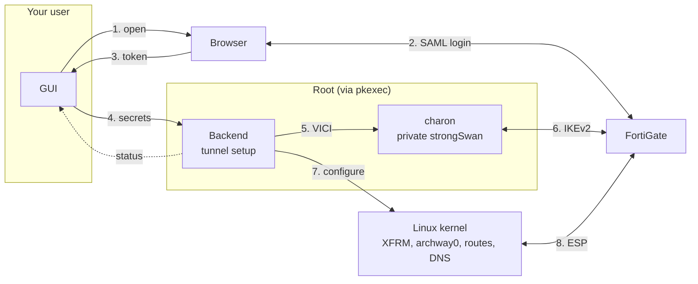

# Archway

Connect to your FortiGate IPsec (IKEv2) VPN with single sign-on, on Linux. Fortinet's own FortiClient can't do that, thanks to Archway, you finally can.

Archway is essentially a desktop frontend for [strongSwan](https://www.strongswan.org/), the mature and widely used open-source IPsec implementation. strongSwan handles the key exchange, encryption and tunnel. Archway adds the FortiGate SSO login and sets up routes and DNS.

> [!WARNING]
> Archway is in a very early stage. Expect bugs and rough edges. If something breaks, please open an issue with the log (turn on verbose logging in Settings first).
>
> Archway is a side project. Its main use is connecting to company networks. If you rely on a VPN to keep your traffic private or secure, please use another solution.


## Features

- **Single sign-on (SAML).** Log in through your own browser, with your organisation's usual login page, password manager and MFA.
- **Built on strongSwan.** The VPN connection itself is handled by [strongSwan](https://www.strongswan.org/), the mature and stable open-source IPsec implementation.
- **Username and password, too.** No SSO? Archway also supports classic username/password logins and pre-shared-key-only setups.
- **Flexible routing.** Send only your company's networks through the VPN, route all traffic through it, or pick the networks yourself.
- **Leak protection.** Archway uses the VPN's DNS so internal servers resolve by name, and in full-tunnel mode it blocks IPv6 so nothing bypasses the VPN.
- **Familiar settings.** Setting names and sections mirror FortiClient's, so you can copy a working configuration field by field. Most defaults match FortiClient's too; certificate verification on the SSO port is on by default.
- **Multiple connections.** Save as many VPN profiles as you need and switch between them in one click.
- **Secure secret storage.** Your VPN key and password are stored securely in your system's password manager (KWallet, GNOME Keyring, KeePassXC), never in a plain file.
- **Easy sharing.** Hand a working connection to a colleague as a single file.
- **Live status.** See your VPN address, connection time and traffic at a glance.
- **Minimal privileges.** Archway asks for your administrator password only when connecting, and the app itself never runs as administrator.

## Supported platforms

Tested on:

- Fedora 44
- Ubuntu 26.04.1

The release packages should also run on Debian 12 and 13, Ubuntu 24.04 and most other distributions released since late 2022 (glibc 2.36 or newer), but those haven't been tested. The technical requirements can be found [under 'requirements'](#requirements).

## Install

Download the `.rpm` (Fedora) or `.deb` (Debian, Ubuntu) from the [latest release](../../releases/latest) and install it with your package manager, which also installs strongSwan and the other dependencies:

```bash
sudo dnf install ./archway-vpn-*.rpm
sudo apt install ./archway-vpn_*.deb
```

On Arch Linux, build the package with the PKGBUILD in `packaging/aur/`. To build from source, see [Build and run](#build-and-run).

## Usage

1. Click **New Connection** and fill in the Connection card:
   - **Remote Gateway:** the FortiGate address, for example `vpn.example.com`.
   - **Pre-shared Key:** the phase 1 PSK. You need it even with SSO, because the gateway uses it to prove who it is.
2. Under **Sign-in**:
   - With SSO, turn on *Enable Single Sign On (SSO) for VPN Tunnel* and set **SSO Port** to the FortiGate's `auth-ike-saml-port`, for example 10443.
   - Without SSO, choose *Username and password (EAP)* or *None (pre-shared key only)*.
3. If your FortiGate or EMS profile needs it, adjust **VPN Settings**, **Phase 1**, **Phase 2** and **Network**. The defaults are FortiClient's: AES128-SHA1 and AES256-SHA256 with DH group 20.
4. Click **Connect**. With SSO your browser opens; log in there. Then the system asks for your password. Once the tunnel is up, the status shows **Connected**.
5. Click **Disconnect** to close the tunnel. Closing the window disconnects too.

In **Settings** you can regenerate the Client UID (the FortiClient-style ID sent to the FortiGate) and turn on verbose logging. Encryption keys are never logged.

## Limitations

- IPv4 only, both inside the tunnel and for the gateway address.
- One connection at a time.
- Not supported: IKEv1, IPsec over TCP, SSL VPN, client certificates, FortiToken push or OTP challenges, EMS / ZTNA compliance checks.

For SSL VPN, client certificates and FortiToken MFA, use Fortinet's free, VPN-only [FortiClient](https://www.fortinet.com/support/product-downloads). EMS / ZTNA compliance checks need the licensed FortiClient with EMS.

FortiClient doesn't always work well on Linux, though, and some newer distributions can't install it at all. Archway only does IKEv2 for now, but if you need SSL VPN, IKEv1 or one of the other features above, please [open an issue](../../issues). We can consider adding it if there's enough demand.

## Trademarks

Fortinet®, FortiGate® and FortiClient® are registered trademarks of Fortinet, Inc. Archway is an independent project, not affiliated with, endorsed by or sponsored by Fortinet. The names are used only to say which VPN gateways Archway works with.

## License

Licensed under either of

- Apache License, Version 2.0 ([LICENSE-APACHE](LICENSE-APACHE) or <https://www.apache.org/licenses/LICENSE-2.0>)
- MIT license ([LICENSE-MIT](LICENSE-MIT) or <https://opensource.org/licenses/MIT>)

at your option.

### Contribution

Unless you explicitly state otherwise, any contribution intentionally submitted for inclusion in the work by you,
as defined in the Apache-2.0 license, shall be dual licensed as above, without any additional terms or conditions.

## Technical details

### Requirements

| | |
|---|---|
| OS | Linux with XFRM interface support (kernel ≥ 4.19) |
| strongSwan | `charon-systemd` with the EAP plugins: Fedora `strongswan`, Debian/Ubuntu `charon-systemd strongswan-swanctl libstrongswan-standard-plugins libcharon-extra-plugins libcharon-extauth-plugins`, Arch `strongswan`. The app runs its own private instance; the system `strongswan` service doesn't need to run. libreswan can't be used because it has no EAP-MSCHAPv2. |
| Runtime tools | `pkexec` (polkit) with a desktop polkit agent, `xdg-open`; a `resolvconf` implementation for VPN DNS |
| Keyring (optional) | a Secret Service provider (GNOME Keyring, KWallet, KeePassXC) to remember the PSK and password; without one they're kept in memory until the app closes |
| Build | Rust ≥ 1.95, `cargo` |
| Display | X11 or Wayland; OpenGL rendering via glow |

EAP methods are MSCHAPv2, GTC and MD5; the FortiGate picks one. DNS goes to the system through `resolvconf` (systemd-resolved, openresolv or Debian resolvconf). Routing all DNS queries through the VPN in full-tunnel mode needs systemd-resolved.

### Build and run

```bash
cargo build --release
./target/release/archway-vpn
```

With rustup, cargo uses the Rust version pinned in `rust-toolchain.toml` and installs it if needed.

The binary is self-contained. When you connect, it starts a second copy of itself as root (`pkexec archway-vpn --backend`).

| Command | Purpose |
|---|---|
| `archway-vpn` | Start the GUI |
| `archway-vpn --backend` | Internal: the privileged backend started by pkexec |

Set `ARCHWAY_BROWSER=<command>` to open the SSO page with something other than `xdg-open`.

### How it works



1. The GUI starts a SAML session at the FortiGate and opens the SSO page in your browser.
2. You log in through the browser (HTTPS).
3. The FortiGate redirects the browser to a local callback in the GUI, carrying the SSO token.
4. The GUI hands settings, PSK and SSO token to the backend over stdin.
5. The backend starts a private charon and loads the connection and secrets over its VICI socket.
6. charon runs IKEv2 + EAP with the FortiGate (UDP 500/4500) and gets the virtual IP and DNS servers.
7. The backend creates archway0 over netlink, then adds the address and routes; charon hands DNS to resolvconf. The backend then switches to your user.
8. The kernel encrypts and carries the ESP traffic.

The backend reports status events back to the GUI over stdout.

- The backend is root only while it sets up the tunnel. Then it switches to your user and keeps two capabilities: network admin, to tear the tunnel down again, and kill, to stop its strongSwan instance.
- strongSwan's charon handles IKE, rekeying and the kernel IPsec SAs. It runs as a private instance with its own config and control socket, and stops when the backend exits.
- Secrets (PSK, SSO token, password) reach the backend over a pipe and charon over its control socket. They never appear on a command line or in a file. The stdin pipe then acts as the control channel: a `disconnect` line, or EOF when the GUI exits or crashes, makes the backend clean up and exit.
- If the backend is killed outright, its interface and routes stay until the next Connect (or a reboot), which removes them.

#### Source layout

| File | Role |
|---|---|
| `src/main.rs` | app state and button actions; dispatches `--backend` |
| `src/view.rs` | what the window shows: connection list, status card, editor, settings, log |
| `src/form.rs` | editing typed settings as text, with errors under the field |
| `src/theme.rs` | colours, fonts and custom widgets |
| `src/glide.rs` | eased mouse-wheel scrolling |
| `src/diag.rs` | error messages for the log and the banner |
| `src/config.rs` | profile model, defaults, TOML settings files and state |
| `src/keyring.rs` | PSK / password storage in the Secret Service |
| `src/protocol.rs` | GUI ↔ backend messages |
| `src/backend.rs` | connection session, pkexec bridge, privileged session (charon + tunnel + privilege drop) |
| `src/charon.rs` | private strongSwan charon: config, start, connection and secrets over VICI, error messages |
| `src/vici.rs` | strongSwan VICI client |
| `src/net.rs` | checked value types (interface names, networks, DNS names, proposals, secrets) |
| `src/netlink.rs` | kernel interface / address / route setup over netlink |
| `src/resolved.rs` | full tunnel: route all DNS queries to the VPN (systemd-resolved, D-Bus) |
| `src/privdrop.rs` | switch to the user with only CAP_NET_ADMIN and CAP_KILL |
| `src/tunnel.rs` | tunnel plumbing and teardown |
| `src/saml.rs` | FortiGate SAML flow and local callback server |
| `src/tls.rs` | rustls HTTPS client with system CAs and AIA intermediate fetching |

### Configuration and security

- Settings are saved when you click **Save Changes**, under `~/.config/archway-vpn/` (or `$XDG_CONFIG_HOME`), mode `0600` in a `0700` directory. Closing with unsaved changes asks first.
  - `config.toml`: app settings (client UID, verbose logging).
  - `profiles/<connection name>.toml`: one file per connection. To share a connection, click **Share** and send the file. The recipient puts it in their `profiles/` folder, restarts the app and enters the PSK.
  - Both only contain settings that differ from the defaults.
- `~/.local/state/archway-vpn/state.json` (or `$XDG_STATE_HOME`) holds which connection is selected and the internal ids that link connections to their keyring items. The app manages it; don't edit it.
- A connection file that can't be read is reported at startup and left untouched. A `config.toml` that can't be read is reported and replaced on the next save.
- Every setting is checked when a file is read and while you type. A connection file with an invalid value (an interface name with a space, a route such as `10.1.2.3/16` with host bits set, a username with non-ASCII characters) is reported and left alone. In the editor, a refused field says why underneath, Save and Connect stay disabled until it's fixed, and the connection is marked ⚠ in the list.
- `custom_routes` is a list: `custom_routes = ["10.0.0.0/8", "192.168.10.0/24"]`.
- The PSK and a saved password are not in these files. They're in your desktop keyring through the freedesktop Secret Service, as items labelled `Archway VPN: <connection> (PSK)` / `(password)`. Without a Secret Service they're kept in memory until the app closes.
- A password is stored only if *Save password* is ticked; otherwise it stays in memory until the app closes.
- The SSO token is single-use and never written to disk.
- The browser hands the SSO token to a listener on `127.0.0.1`. The FortiGate builds that callback URL, so it can't carry a secret of Archway's, and the listener can't fully prove the request is your login's. It refuses requests from other users' processes and requests a web page sends itself (scripts, forms, images, frames). A forged callback could still sign you in with someone else's account, so Archway shows which account you signed in with, and warns when it differs from the connection's previous login. The accounts are kept in `~/.local/state/archway-vpn/sso-users.json`.
- TLS on the SSO port:
  - *Verify the server certificate* uses the system CA store.
  - If the FortiGate omits its intermediate certificate, the app fetches it from the certificate's AIA URL, as browsers do. Downloaded certificates are only used as untrusted intermediates.
  - Verification is on by default. With it off, any certificate is accepted, as in FortiClient's default setup, and anyone on the network path can send you to a fake login page. The editor warns about this under the checkbox.
- Dependencies, rustls among them, are compiled into the binary, so security fixes in them ship as a new Archway release. CI checks `Cargo.lock` against the RustSec advisory database on every change and weekly.
- The pkexec prompt names the binary path. Run the app from a location that only you (or root) can write to.
- The backend runs no shell and no external commands. It configures the kernel over netlink, hands DNS to the standard `resolvconf` (through strongSwan) and controls strongSwan over its VICI socket. Interface names, routes, gateway names and proposals are checked against strict formats before anything runs as root, so a shared profile or a gateway can't inject commands.
- strongSwan runs as a private instance with its own config and control socket in `/run/archway-vpn` (root only), with a fixed plugin list.
- Fortinet-specific Mode Config extras (split networks sent as Fortinet attributes, search domain, banner) and Fortinet private notifies (license blob, EMS serial) aren't used. Routes come from the traffic selectors or from the custom routes in the profile.
- The xfrm `if_id` and route tag are fixed, which is why only one connection can be up at a time.

### Testing

```bash
cargo test                       # unit tests: value checks, VICI, charon config/messages, request building, app
./scripts/netns-test.sh          # kernel tests, each in a throwaway network namespace (no root needed)
```

End to end: connect with the app (turn on verbose logging in Settings) and check the tunnel with `ip -br addr show archway0` and `ip route show proto 233`.
